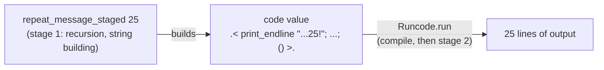

# merry-fxmas in MetaOCaml

[](https://github.com/FranklinChen/merry-fxmas-metaocaml/actions/workflows/CI.yml)

A program that **writes a program and then runs it**. It prints "Merry Christmas" 25 times, counting down, but it does so in two stages: first it *generates* code that prints the greetings, then it *compiles and runs* that code. It is a small, complete introduction to **multi-stage programming** with [BER MetaOCaml](https://okmij.org/ftp/ML/MetaOCaml.html).

```console
$ dune exec merry-fxmas
Merry Christmas Bill 25!
Merry Christmas Bill 24!
...
Merry Christmas Bill 1!
```

- [Quick start](#quick-start)
- [The idea: two stages](#the-idea-two-stages)
- [A guided tour of the generator](#a-guided-tour-of-the-generator)
- [What runs when](#what-runs-when)
- [Try it yourself](#try-it-yourself)
- [How the tests prove the code is staged](#how-the-tests-prove-the-code-is-staged)
- [Project layout](#project-layout)
- [Further reading](#further-reading)

## Quick start

You need [opam](https://opam.ocaml.org/doc/Install.html) 2.x. Everything else is installed by the commands below.

BER MetaOCaml is not a library: it is a patched OCaml compiler, which opam publishes as the compiler variant `ocaml-variants.5.3.0+BER` (BER MetaOCaml N153, based on OCaml 5.3.0). So the first step builds that compiler into an opam switch kept inside this checkout (in `_opam/`, which git ignores), along with the project's dependencies. It takes several minutes, once.

```console
$ opam switch create . ocaml-variants.5.3.0+BER --deps-only --with-test
$ eval $(opam env)
```

Then build, test and run:

```console
$ dune build
$ dune test
$ dune exec merry-fxmas
```

## The idea: two stages

An ordinary program does its work when it runs. A *staged* program splits its work in two:

1. **Stage 1, generation.** Run code that builds a *code value*: a typed piece of program, not yet executed.
2. **Stage 2, execution.** Compile that code value and run it.

Why bother? Because stage 1 can do work *once*, ahead of time, so that the generated code has less to do. Here, stage 1 performs the recursion over the count and builds every greeting string; stage 2 is left with nothing but 25 `print_endline` calls on constant strings: no loop, no counter, no arithmetic, no string building.



This program is a toy, so the savings do not matter, but the same technique produces fast specialized code in real systems: parsers, numeric kernels, query compilers. MetaOCaml's guarantee is what makes it pleasant: **if the generator type-checks, the code it generates type-checks too**.

## A guided tour of the generator

The whole generator is in [`src/merry_fxmas.ml`](src/merry_fxmas.ml):

```ocaml
let rec repeat_message_staged n =
  if n > 0 then
    let s = "Merry Christmas Bill " ^ string_of_int n ^ "!" in
    .<
      begin
        print_endline s;
        .~(repeat_message_staged (n-1))
      end
    >.
  else
    .< () >.
```

Its type, from [`src/merry_fxmas.mli`](src/merry_fxmas.mli), says it all: it takes an `int` and returns a *code value* that, when run, produces `unit`.

```ocaml
val repeat_message_staged : int -> unit Codelib.code
```

MetaOCaml adds two constructs to OCaml:

| Syntax | Name | Meaning |
| --- | --- | --- |
| `.< e >.` | bracket | Do not evaluate `e` now; build code for it. If `e : t`, then `.< e >. : t code`. |
| `.~ e` | escape | Inside a bracket only: evaluate `e` *now* (it must be a `t code`) and splice the resulting code in place. |

Read the function with those in mind:

- `if n > 0` and `let s = ...` are **outside** any bracket, so they run in stage 1. `s` is an ordinary string such as `"Merry Christmas Bill 25!"`.
- `.< begin print_endline s; ... end >.` is a bracket, so it is **code**, not an action: nothing is printed when the generator runs.
- `s` is a stage-1 value used inside the bracket. MetaOCaml carries it across to stage 2 (this is called *cross-stage persistence*); for a string it simply inlines the literal.
- `.~(repeat_message_staged (n-1))` escapes back to stage 1: it calls the generator recursively *right now* and splices the code it returns into this code.
- The base case `.< () >.` is the code for "do nothing".

So the recursion unrolls completely during generation. For `n = 3` the result is exactly:

```ocaml
.<
Stdlib.print_endline "Merry Christmas Bill 3!";
Stdlib.print_endline "Merry Christmas Bill 2!";
Stdlib.print_endline "Merry Christmas Bill 1!";
()>.
```

Finally, [`bin/main.ml`](bin/main.ml) is one line: `Runcode.run` compiles the 25-greeting code value and executes it.

```ocaml
let () = Runcode.run Merry_fxmas.action_code
```

## What runs when

| Work | Stage 1 (generation) | Stage 2 (generated code) |
| --- | --- | --- |
| Testing `n > 0`, recursing on `n - 1` | yes | no |
| `string_of_int n` and the `^` concatenations | yes | no |
| `print_endline` | no | yes, 25 times |

The boundary is not something the compiler infers: **you draw it**, with brackets and escapes. That explicitness is the point. Move a computation inside a bracket and it moves to stage 2; the next section shows this.

## Try it yourself

The switch includes `metaocaml`, a toplevel (REPL) that understands brackets and escapes. Start it from the project root, after `eval $(opam env)`:

```console
$ metaocaml
```

**Build and combine code values.** Brackets produce code; escapes splice code into code:

```ocaml
# .< 2 + 4 >.;;
- : int code = .<2 + 4>.
# let x = .< 2 + 4 >. in .< .~x + .~x >.;;
- : int code = .<(2 + 4) + (2 + 4)>.
# Runcode.run .< 2 + 3 >.;;
- : int = 5
```

An escape makes sense only inside a bracket, and MetaOCaml rejects one outside:

```ocaml
# .~ .< 2 + 3 >.;;
Line 1, characters 0-14:
1 | .~ .< 2 + 3 >.;;
    ^^^^^^^^^^^^^^
Error: An escape may appear only within brackets
```

**Load the generator and stage a small countdown.** Generating code prints nothing; only running it does:

```ocaml
# #use "src/merry_fxmas.ml";;
val repeat_message_staged : int -> unit code = <fun>
val action_code : unit code = .<
  Stdlib.print_endline "Merry Christmas Bill 25!";
  (... 23 more lines ...)
  Stdlib.print_endline "Merry Christmas Bill 1!";
  ()>.
# repeat_message_staged 3;;
- : unit code = .<
Stdlib.print_endline "Merry Christmas Bill 3!";
Stdlib.print_endline "Merry Christmas Bill 2!";
Stdlib.print_endline "Merry Christmas Bill 1!";
()>.
# Runcode.run (repeat_message_staged 3);;
Merry Christmas Bill 3!
Merry Christmas Bill 2!
Merry Christmas Bill 1!
- : unit = ()
```

**Move work to the other stage.** Here is a variant that builds the string *inside* the bracket instead of before it:

```ocaml
# let rec late n =
    if n > 0 then
      .< begin
           print_endline ("Merry Christmas Bill " ^ string_of_int n ^ "!");
           .~(late (n-1))
         end >.
    else .< () >.;;
val late : int -> unit code = <fun>
# late 2;;
- : unit code = .<
Stdlib.print_endline
  ("Merry Christmas Bill " ^ ((Stdlib.string_of_int 2) ^ "!"));
Stdlib.print_endline
  ("Merry Christmas Bill " ^ ((Stdlib.string_of_int 1) ^ "!"));
()>.
```

The output is the same, but the conversion and concatenations now happen every time the generated code runs. Only `n` itself, a stage-1 integer, is carried across as a literal. Where a computation sits relative to the brackets decides which stage pays for it.

**Exercise: stage `power`.** The classic first staging exercise is specializing `x` to the power `n` for a fixed `n`. Try writing it before reading the solution:

```ocaml
# let rec power n x =
    if n = 0 then .< 1 >. else .< .~x * .~(power (n - 1) x) >.;;
val power : int -> int code -> int code = <fun>
# let power5 = .< fun x -> .~(power 5 .<x>.) >.;;
val power5 : (int -> int) code = .<
  fun x_1 -> x_1 * (x_1 * (x_1 * (x_1 * (x_1 * 1))))>.
# let f = Runcode.run power5;;
val f : int -> int = <fun>
# f 2;;
- : int = 32
```

The recursion on `n` is gone from the generated function; what remains is straight multiplication. Notice also that MetaOCaml renamed `x` to `x_1`: generated code is *hygienic*, so a variable bound in generated code can never be captured by accident.

## How the tests prove the code is staged

`dune test` runs two checks, and they guard different things:

- [`test/main.expected`](test/main.expected) is the expected output of the installed `merry-fxmas` program: what a user sees.
- [`test/print_code.expected`](test/print_code.expected) is the expected **generated code**, printed by [`test/print_code.ml`](test/print_code.ml) with `Codelib.print_code` and never run.

The output test alone cannot tell a staged program from an unstaged one: a generator returning `.< for i = 25 downto 1 do ... done >.` prints the same 25 lines. The generated-code test can: change where work happens (try the `late` variant above in `src/merry_fxmas.ml`) and `dune test` fails with a diff of the generated code while the output test still passes. If the change is intended, accept the new expectation with `dune promote`.

## Project layout

| Path | Contents |
| --- | --- |
| [`src/merry_fxmas.ml`](src/merry_fxmas.ml) | The staged generator (library `merry_fxmas`). |
| [`bin/main.ml`](bin/main.ml) | The `merry-fxmas` program: runs the generated code. |
| [`test/`](test/) | The two tests described above. |
| [`dune-project`](dune-project) | Package metadata; `merry-fxmas.opam` is generated from it. |
| [`docs/ARCHITECTURE.md`](docs/ARCHITECTURE.md) | How the build is wired to the MetaOCaml compiler, and why. |
| [`AGENTS.md`](AGENTS.md) | Working rules for contributors and coding agents. |

`merry-fxmas.opam` is generated: edit `dune-project` instead, then run `dune build @opam` and `dune promote`. CI fails if the two disagree.

## Further reading

- [BER MetaOCaml home page](https://okmij.org/ftp/ML/MetaOCaml.html), especially its "Introduction to staging and MetaOCaml" and "Cross-stage persistence" sections.
- [Reconciling Abstraction with High Performance: A MetaOCaml approach](https://okmij.org/ftp/meta-programming/tutorial/), a full tutorial.
- [docs/ARCHITECTURE.md](docs/ARCHITECTURE.md) for why the executables are bytecode and how dune links MetaOCaml's runtime library.
