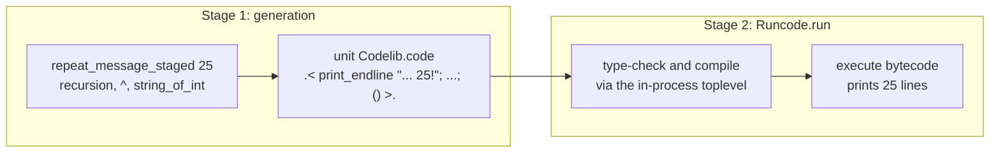
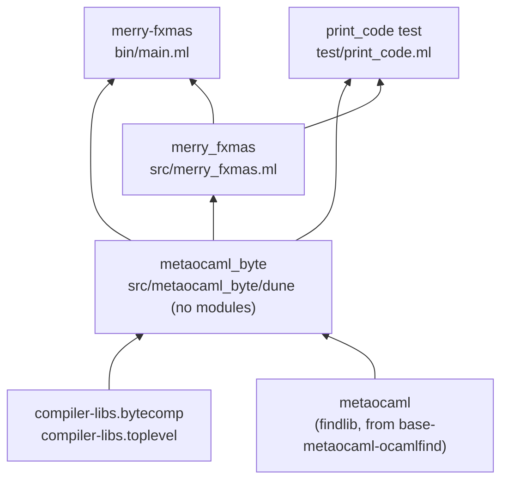

# Architecture

This project is a demonstration of multi-stage programming with BER MetaOCaml: a program that writes a program and then runs it. The [README](../README.md) teaches the staging itself. This document explains how the code is laid out and how dune and opam are wired to a compiler that is not stock OCaml. The wiring has several non-obvious parts, collected under [Tricky parts](#tricky-parts); code comments elsewhere point here rather than repeat them.

## The two stages

`Merry_fxmas.repeat_message_staged n` is ordinary recursive OCaml that returns a *code value* (`unit Codelib.code`) instead of performing any output. Its recursion, string concatenation and `string_of_int` all run in the first stage. What survives into the second stage is straight-line code, 25 `print_endline` calls on literal strings, which `test/print_code.expected` records exactly.



## Layout and dependencies



| Path | Role |
| --- | --- |
| `src/metaocaml_byte/dune` | Library `metaocaml_byte`: no code, only the correct set and order of link dependencies for MetaOCaml in bytecode. Everything depends on this instead of on `metaocaml` directly. |
| `src/merry_fxmas.ml`, `.mli` | Library `merry_fxmas`: the staged generator. Builds code, never runs it. |
| `bin/main.ml` | Executable `merry-fxmas`: runs `Merry_fxmas.action_code` with `Runcode.run`. |
| `test/dune` | The two tests (see [Why two tests](#why-two-tests)). |
| `test/print_code.ml` | Prints the generated code with `Codelib.print_code`, without running it. |
| `dune-project` | Single source of package metadata; `merry-fxmas.opam` is generated from it. |
| `.github/workflows/CI.yml` | Lints, builds, tests and runs on Linux and macOS. |

The generator lives in a library, separate from the executable, so that a test can inspect the code value directly.

## Why two tests

- The rule pair in `test/dune` runs the *installed* `merry-fxmas` (`%{bin:merry-fxmas}`) and diffs its output against `test/main.expected`. This is what a user sees.
- The `(test (name print_code) ...)` stanza runs `test/print_code.ml` and diffs its output against `test/print_code.expected`: the generated code itself.

The output test alone cannot distinguish the staged program from an unstaged one: a generator returning `.< for i = 25 downto 1 do ... done >.` prints the same 25 lines. The generated-code test pins the shape of the code, so a change that moves work between stages fails it even though the output is unchanged. Both run under `dune test`; an intended change to the generated code is accepted with `dune promote`.

## Tricky parts

### The compiler is the dependency

BER MetaOCaml is a patched OCaml compiler, published in opam as the compiler variant `ocaml-variants.5.3.0+BER` (release N153). It cannot be installed as a library into an existing switch; it has to be the switch's compiler. That is why the README creates a dedicated local switch and CI passes it to `ocaml/setup-ocaml` as `ocaml-compiler`. In CI, setup-ocaml caches the switch, so the compiler (the slow part) is rebuilt only on a cache miss; the other dependencies are deliberately installed fresh on every run, so that upstream changes surface instead of hiding behind a stale cache.

### No `metaocamlc` needed

The project used to build with `ocamlbuild -ocamlc metaocamlc`. `metaocamlc` is only a small C wrapper around the patched `ocamlc` that adds `-open Codelib` and, when linking, the MetaOCaml archives. Neither is needed under dune:

- The patched compiler parses `.< >.` and `.~` by default (`Clflags.metaocaml_mode` starts out `true`), so the plain `ocamlc` that dune invokes understands staging syntax.
- `-open Codelib` is replaced by naming `Codelib.code` explicitly in `src/merry_fxmas.mli`.
- The archives come from the findlib library `metaocaml`, through `metaocaml_byte`.

### The `metaocaml` findlib library needs `ocamlfind`

The `metaocaml` library's `META` file is installed by the opam package `base-metaocaml-ocamlfind`, but only if `ocamlfind` is installed: `ocamlfind` is merely an optional dependency (depopt) of it. Without `ocamlfind`, dune reports `Library "metaocaml" not found`. So `dune-project` lists `ocamlfind` as a dependency even though dune never runs it. When `ocamlfind` arrives after `base-metaocaml-ocamlfind`, opam reinstalls the latter, which then writes the `META`.

`base-metaocaml-ocamlfind` is itself already a dependency of the compiler package; `dune-project` names it anyway because this project relies on its `META` directly.

### Dune ignores `requires(byte)`

The `META` declares:

```
requires = "compiler-libs.common"
requires(byte) = "compiler-libs.bytecomp compiler-libs.toplevel"
archive(byte) = "metalib.cma berstart.cmo"
```

Dune honours the `archive(byte)` predicate but does not take dependencies from predicate-qualified `requires(byte)`. Depending on `metaocaml` alone, linking fails with `No implementation provided for ... Toploop` and `Errors`. `src/metaocaml_byte/dune` restores the missing dependencies once, as a library with no modules:

```
(library
 (name metaocaml_byte)
 (modules)
 (libraries compiler-libs.bytecomp compiler-libs.toplevel metaocaml))
```

Their order in that list matters: with `metaocaml` first, linking fails with `Wrong link order: "Berstart" ... depends on "Toploop"`. Because every other stanza depends on `metaocaml_byte`, the correct link order comes from the dependency graph, and no executable has to repeat it. Do not add `metaocaml` directly to a stanza's `libraries`.

### Bytecode only

`Runcode.run` compiles the generated code with the toplevel machinery (`Toploop`) inside the running process and executes the resulting bytecode. That machinery exists only in bytecode programs, so the library, executable and test are all `(modes byte)`. `berstart.cmo`, linked ahead of the program's own modules, initialises the toplevel environment before `main.ml` runs.

You may notice `_build/default/bin/main.exe` alongside `main.bc`. Dune still provides a `.exe` target for a byte-only executable, building it with `ocamlc -output-complete-exe`: it is bytecode with the runtime embedded, not native code, so it runs correctly too.

BER MetaOCaml also offers `Runnative`, which runs `ocamlopt -shared` on the generated code at run time and loads the result with `Dynlink`; this project does not use it.

### Generated opam file is promoted by hand

Since dune 3.23, generated `.opam` files are not promoted into the source tree automatically. `dune build @opam` (and `dune test`) produce the file and report a diff against the committed one; `dune promote` accepts it. CI runs `dune build @opam` as its own step, so a stale `merry-fxmas.opam` fails with an obvious name.

### Brackets and locally defined types

A BER MetaOCaml restriction worth knowing before extending the generator: data constructors and record labels used inside brackets must come from separately compiled modules. A `type t = A` declared in `merry_fxmas.ml` cannot be used as `.< A >.`; move such types to their own module.

## Possible upstream fixes

Two of the workarounds above exist because of how `base-metaocaml-ocamlfind` (in ocaml/opam-repository, with its `META` in ocaml/opam-source-archives) packages the `META`. This project has not reported either; search for an existing issue before filing one.

- Its install step runs `ocamlfind install` only when `ocamlfind` is installed. Copying the `META` into place unconditionally would remove the need for the `ocamlfind` dependency.
- Its `META` uses `requires(byte)` and `requires(native)`, which dune does not evaluate. Splitting it into subpackages (a common part, a bytecode runner requiring the toplevel, a native runner requiring `dynlink`) would make `metaocaml_byte` unnecessary.

If either lands, delete the corresponding workaround and its section here.
